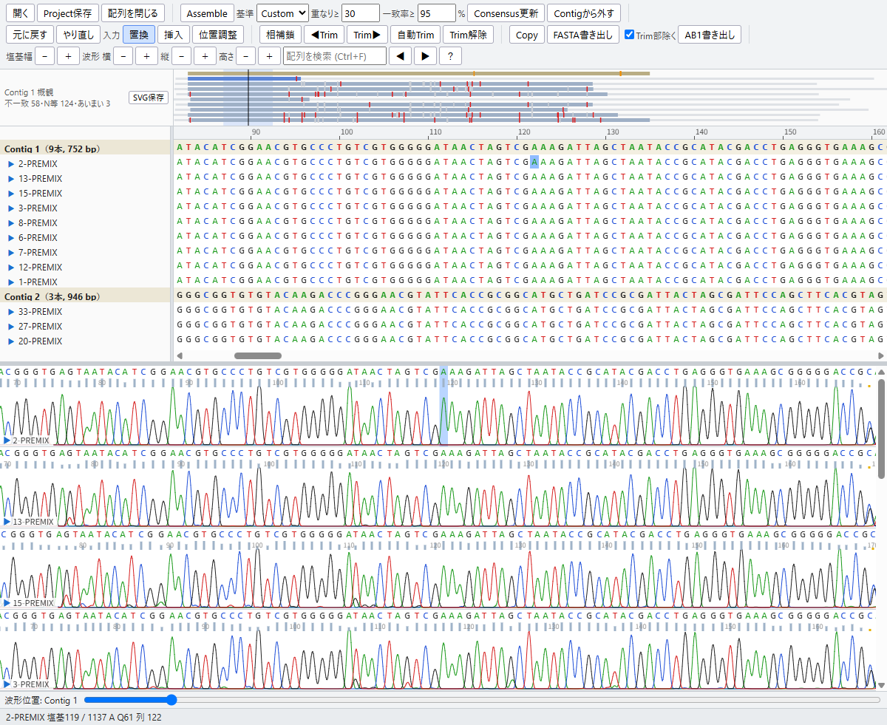

# Sanger Assembler

A single-file, browser-based tool to assemble, view and edit Sanger sequencing traces (.ab1).
No installation, no server: your data never leaves your browser. The user interface is currently in Japanese only.

Sangerシーケンスの波形ファイル（.ab1）を、ブラウザだけでアセンブル・表示・編集するツールです。
`index.html` 1ファイルで動きます。インストールもサーバーも不要です。

## 使う

- オンライン: https://mkameya.github.io/sanger-assembler/
- オフライン: `index.html` をダウンロードして Chrome / Edge で開く。

読み込んだ配列はブラウザの中だけで処理され、外部には送信されません。

## できること

- **読み込み**: .ab1 / .abi、FASTA、このツールのプロジェクト(.json)。これらをまとめたzipもそのまま開けます。複数同時、ドラッグ＆ドロップ可。後から追加も可。
- **表示**: 配列表示と波形表示が連動。コンティグ全長の不一致マップ（概観図）。不一致は赤、配列側の N・あいまい塩基は灰色で区別します。塩基配列の検索。
- **編集**: 塩基の置換・挿入・削除、複数行のブロック選択、相補鎖（逆相補）への変換、トリム範囲の変更、アラインメントの手動調整（位置調整モード）、Undo / Redo。
- **アセンブル**: 向きは自動判定。基準は3段階（厳しい・標準・緩い）と任意設定。選択した配列だけのアセンブル、既存コンティグへの追加。
- **保存**: プロジェクト(.json、元の波形データを内包)、FASTA（配列・コンセンサス）、編集を反映した .ab1、概観図のSVG。

- **スマホ・タブレット**: 表示、Assemble、保存・書き出しなどが可能。塩基の編集や範囲選択はキーボードとマウスが必要です。

操作の詳細は画面右上の「？」に書いてあります。

## 基本の流れ

1. .ab1 をドラッグ＆ドロップ、または「開く」。
2. 「Assemble」でコンティグを作る。
3. 「Project保存」で作業状態を保存。必要なら FASTA などを書き出す。

## 注意

- Chrome / Edge を想定しています。画面は日本語のみです。
- 読み込める形式は .ab1 / .abi、FASTA、このツールのプロジェクト(.json)、およびそれらをまとめた zip です。SCF・FASTQ・GenBank、パスワード付きの zip は未対応です。
- 想定規模は数十本までです。
- 本ツールは無保証です。アセンブルやコンセンサスの結果は、必ず波形と照らして確認してください。

## ライセンス

MIT License（`LICENSE` を参照）。
